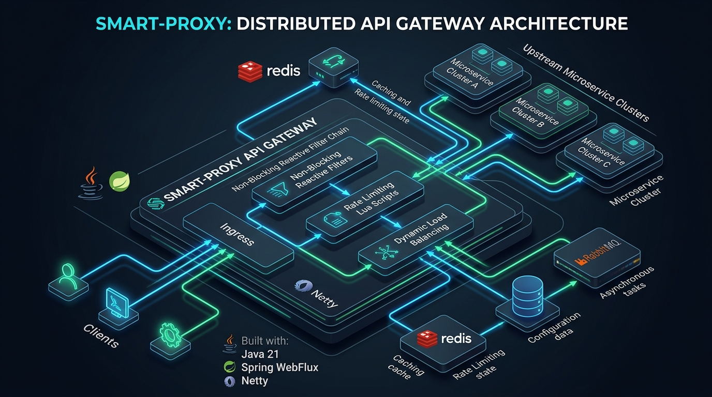
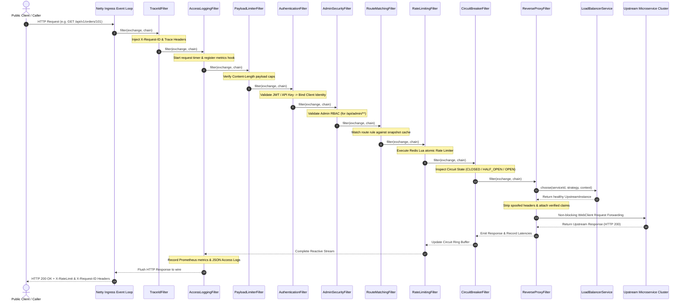
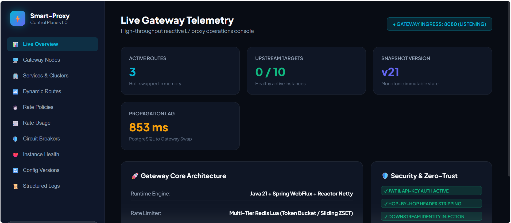

<div align="center">

# 🚀 Smart-Proxy: Distributed API Gateway & Control Plane

### High-Performance, Reactive, Distributed L7 API Gateway with Zero-Downtime Hot-Swappable Configuration, Atomic Rate Limiting, and Operations Dashboard

[](https://www.oracle.com/java/)
[](https://spring.io/projects/spring-boot)
[](https://docs.spring.io/spring-framework/reference/web/webflux.html)
[](https://reactjs.org/)
[](https://www.typescriptlang.org/)
[](https://redis.io/)
[](https://www.postgresql.org/)
[](https://www.rabbitmq.com/)
[](https://www.docker.com/)

---

</div>

## 📌 System Architecture





---

## 🖥️ Operations Dashboard



The project includes an **Operations Dashboard** built with **React 18**, **TypeScript**, **Tailwind CSS**, and **Vite** for monitoring gateway telemetry, managing dynamic routes, configuring rate-limiting policies, inspecting circuit breaker state matrices, and auditing administration events in real time.

---

## 🔥 Key Features

### ⚡ Non-Blocking Reactive Architecture
* Built on **Spring WebFlux** and **Netty** event loop for low memory overhead and high throughput.
* End-to-end non-blocking reactive filter chain (`WebFilter`) handling ingress routing, header transformation, authentication, and forwarding.

### 🔄 Zero-Downtime Configuration Hot-Swap
* Authoritative relational state persisted in **PostgreSQL 16**.
* Asynchronous cache invalidation and snapshot updates broadcast across nodes via **RabbitMQ** (`CONFIG_UPDATED` AMQP events).
* Lock-free atomic reference swaps (`AtomicReference<GatewaySnapshot>`) ensure zero request drops during config reloads.

### 🛡️ Distributed Multi-Tier Rate Limiting
* High-precision **Redis Lua** scripts implementing **Token Bucket** and **Sliding Window Log** algorithms.
* Rate limiting by IP address, authenticated API Key, JWT tenant, or dynamic headers.
* Cluster-wide rate enforcement with fallback to local in-memory sliding windows if Redis becomes unreachable.

### ⚖️ L7 Dynamic Load Balancing & Active Health Checks
* Supports **Round-Robin**, **Least-Connections**, **Random**, and **Weighted** routing strategies.
* Passive circuit monitoring alongside active health probes (`/actuator/health` or TCP ping) to automatically eject unhealthy upstream instances.

### 💥 Resilient Circuit Breaking & Fallbacks
* Integrated custom circuit breaking with **CLOSED**, **OPEN**, and **HALF_OPEN** state transitions.
* Configurable failure rate thresholds, ring buffer evaluation windows, and instant fallback response generation.

### 🔑 Multi-Tenant Security & Security Controls
* Public ingress security supporting **JWT signature validation** and **hashed API Key authentication**.
* Administrative control plane guarded by RBAC (`ROLE_ADMIN`, `ROLE_OPERATOR`, `ROLE_AUDITOR`) and secret admin keys.
* Request sanitize filters to strip untrusted headers (`X-Forwarded-For`, `X-User-Id`) and inject verified client metadata.

### 📊 Comprehensive Telemetry & Observability
* Real-time metrics exported via **Micrometer** to Prometheus scrape endpoints (`/actuator/prometheus`).
* Structured JSON access logging with contextual trace correlation (`X-Request-ID`).
* Built-in administrative audit logging tracking every configuration change and state transition.

---

## 🛠️ Tech Stack & Service Matrix

| Component | Technology | Default Port | Description |
| :--- | :--- | :--- | :--- |
| **Backend Gateway** | Java 21 / Spring WebFlux / Netty | `8080` | High-throughput distributed API gateway core |
| **Operations Dashboard** | React 18 / TypeScript / Vite | `5173` | Real-time administrative telemetry & control UI |
| **PostgreSQL** | PostgreSQL 16 Alpine | `5432` | Relational store for routes, services, policies, and audit logs |
| **Redis** | Redis 7.2 Alpine | `6379` | In-memory atomic rate-limiting state store |
| **RabbitMQ** | RabbitMQ 3.13 Management | `5672` / `15672` | AMQP event bus for configuration hot-swap broadcasts |
| **Mock Upstream Node 1** | Node.js / Express | `8091` | Microservice instance 1 |
| **Mock Upstream Node 2** | Node.js / Express | `8092` | Microservice instance 2 |
| **Mock Upstream Node 3** | Node.js / Express | `8093` | Microservice instance 3 |

---

## 🚀 Quick Start Guide

### Prerequisites
- **JDK 21+** (e.g. Temurin 21)
- **Node.js 18+** & `npm`
- **Docker & Docker Compose**

---

### Step 1: Start Infrastructure Services
In the repository root directory, boot the infrastructure containers:

```bash
docker-compose up -d
```

Verify container health:
```bash
docker-compose ps
```

* **PostgreSQL UI / Access**: `localhost:5432` (db: `smartproxydb`, user: `smartproxy`, pass: `smartproxy_dev_secret`)
* **Redis**: `localhost:6379` (pass: `smartproxy_redis_secret`)
* **RabbitMQ Management**: `http://localhost:15672` (user: `smartproxy`, pass: `smartproxy_rabbit_secret`)

---

### Step 2: Start Backend Gateway

```powershell
# Windows PowerShell / Command Prompt
.\mvnw.cmd spring-boot:run
```

```bash
# Linux / macOS
./mvnw spring-boot:run
```

The gateway boots on **`http://localhost:8080`**, connects to PostgreSQL/Redis/RabbitMQ, builds the active configuration snapshot, and starts accepting traffic.

---

### Step 3: Start Operations Dashboard

Open a new terminal window:

```bash
cd dashboard
npm install
npm run dev
```

Navigate to **`http://localhost:5173`** in your browser. The Vite server proxies admin requests seamlessly to the backend.

---

## 🔍 Verification & Health Smoke Test

### 1. Actuator Health Probe
```bash
curl http://localhost:8080/actuator/health
```
*Expected Output*: `{"status":"UP"}`

### 2. Snapshot Version & Sync Status
```bash
curl http://localhost:8080/api/admin/config/snapshot-status \
  -H "X-Admin-Key: admin-super-secret-key-change-in-prod"
```

### 3. Test Proxy Ingress Forwarding
```bash
curl -i http://localhost:8080/api/v1/orders/101 \
  -H "X-API-Key: test-client-key-1"
```

---

## 📚 API Reference Catalog

> [!IMPORTANT]
> Admin endpoints under `/api/admin/**` require the header:  
> `X-Admin-Key: admin-super-secret-key-change-in-prod` or a valid JWT bearer token with administrative roles.

### 🌐 Ingress Proxy Endpoints
| Method | Path Pattern | Required Auth | Description |
| :--- | :--- | :--- | :--- |
| `GET/POST/PUT/DELETE` | `/api/v1/orders/**` | `X-API-Key: <key>` | Forwarded to `order-service` cluster with rate limiting & load balancing |
| `GET/POST/PUT/DELETE` | `/api/v1/payments/**` | `X-API-Key: <key>` | Forwarded to `payment-service` cluster |
| `GET` | `/api/v1/inventory/**` | Optional | Public endpoint with IP-based rate limiting |

### ⚙️ Admin Control Plane & Route Management
| Method | Path | Description |
| :--- | :--- | :--- |
| `GET` | `/api/admin/config/snapshot-status` | Get active snapshot version, checksum, and propagation latency |
| `POST` | `/api/admin/config/sync` | Force database re-sync & broadcast RabbitMQ snapshot update |
| `GET` | `/api/admin/routes` | List all dynamic route rules |
| `POST` | `/api/admin/routes` | Register a new dynamic route |
| `PUT` | `/api/admin/routes/{id}` | Update an existing route rule |
| `DELETE` | `/api/admin/routes/{id}` | Delete a route rule |

### 📈 Telemetry, Health & Circuit Breakers
| Method | Path | Description |
| :--- | :--- | :--- |
| `GET` | `/api/admin/telemetry/stats` | Real-time aggregate RPS, error rates, p50/p95/p99 latencies |
| `GET` | `/api/admin/telemetry/circuit-breakers` | Inspect state matrix across all services (`CLOSED`, `HALF_OPEN`, `OPEN`) |
| `POST` | `/api/admin/telemetry/circuit-breakers/{id}/transition` | Manually override circuit state |
| `GET` | `/actuator/prometheus` | Prometheus metrics scrape endpoint |

---

## 🧪 Testing & Verification Suite

Smart-Proxy includes automated testing suites for unit logic, integration flows, multi-threaded token bucket concurrency, and chaos failure scenarios:

```powershell
# Run entire automated test suite (125+ tests)
.\mvnw.cmd test

# Run Chaos Failure Scenarios
.\mvnw.cmd test -Dtest=ChaosFailureScenariosTest

# Run Concurrency Token Bucket Multi-Node Race Tests
.\mvnw.cmd test -Dtest=DistributedConcurrencyTokenBucketTest

# Run In-Memory Performance Benchmark Harness
.\mvnw.cmd test -Dtest=BenchmarkHarnessTest
```

---

## 📁 Repository Structure

```
Smart-Proxy/
├── dashboard/                 # React 18 + TypeScript Operations Dashboard
│   ├── src/                   # React components, stores & telemetry hooks
│   ├── package.json           # Dashboard dependencies
│   └── vite.config.ts         # Vite build & proxy settings
├── docker/                    # Docker container configs & init scripts
│   ├── postgres/              # PostgreSQL schema & seeds
│   └── mock-upstream/         # Node.js mock microservices
├── docs/                      # Technical documentation & guides
│   ├── images/                # Architecture diagrams & dashboard screenshots
│   └── flo.md                 # Complete request lifecycle specification
├── src/                       # Java 21 Backend Gateway Source Code
│   ├── main/java/com/smartproxy/
│   │   ├── admin/             # Control plane REST controllers & snapshot sync
│   │   ├── core/              # Reactive filter chain & ingress routing logic
│   │   ├── ratelimiter/       # Redis Lua sliding window & token bucket limiters
│   │   ├── resilience/        # Circuit breaking & failure handling
│   │   ├── security/          # JWT, API key authentication & RBAC
│   │   ├── storage/           # JPA entities & PostgreSQL repositories
│   │   └── telemetry/         # Micrometer metrics & structured JSON access logging
│   └── main/resources/        # application.yml, schema.sql & Lua scripts
├── docker-compose.yml         # Container orchestration manifest
├── pom.xml                    # Maven dependencies & build configuration
└── README.md                  # Project overview & reference guide
```

---

## 📄 License

This project is open-source and released under the **MIT License**.
