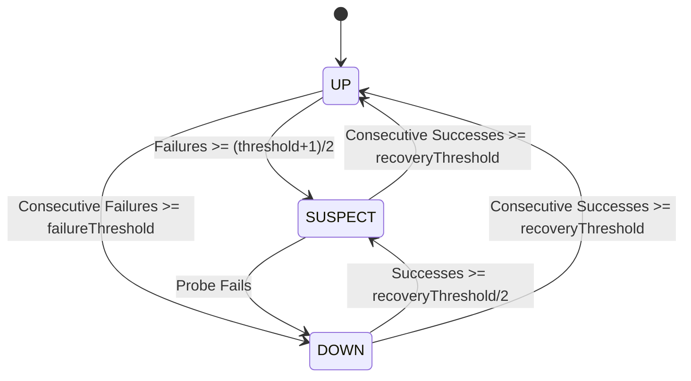
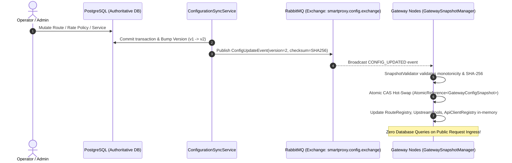

# Smart-Proxy: Staff / Principal Engineer Interview Deep-Dive Guide

This technical guide provides deep-dive interview preparation based directly on the actual **Smart-Proxy** codebase (Java 21+, Spring WebFlux/Netty, Reactive Redis, PostgreSQL, RabbitMQ, and React). Every architectural pattern, mathematical formula, Lua script, and trade-off described below reflects the real repository implementation.

---

## 1. High-Level Architecture & Core Principles

Smart-Proxy is an ultra-high-throughput, zero-trust **Distributed L7 API Gateway, Custom Load Balancer, and Distributed Rate Limiter** built from scratch without relying on third-party proxy frameworks (e.g. NGINX, HAProxy, Spring Cloud Gateway, or Resilience4j).

```mermaid
flowchart TD
    Client([Public Client / API Caller]) -->|HTTPS Request| Ingress[Netty Ingress Event Loop]
    
    subgraph Gateway Pipeline [Gateway WebFilter Execution Pipeline]
        Trace[1. TraceIdFilter] --> Access[2. AccessLoggingFilter]
        Access --> Payload[3. PayloadLimiterFilter (Max 10MB)]
        Payload --> Auth[4. AuthenticationFilter (JWT / SHA-256 API-Key)]
        Auth --> RBAC[5. AdminSecurityFilter (Admin RBAC)]
        RBAC --> Route[6. RouteMatchingFilter (In-Memory RouteRegistry)]
        Route --> RL[7. RateLimitingFilter (Multi-Tier Redis Lua)]
        RL --> CB[8. CircuitBreakerFilter (Custom State Machine)]
        CB --> Proxy[9. ReverseProxyFilter (Custom L7 LB & Retries)]
    end

    Ingress --> Gateway Pipeline

    subgraph Control Plane [Control Plane & State Management]
        PG[(PostgreSQL - Authoritative DB)]
        RMQ{{RabbitMQ Config Exchange}}
        Sync[ConfigurationSyncService]
        Snap[GatewaySnapshotManager - Atomic Swap]
    end

    subgraph Distributed State [Distributed State Store]
        Redis[(Redis Cluster - Atomic Lua Engine)]
    end

    subgraph Upstream Services [Upstream Microservice Clusters]
        SvcA1[Order Service - Node 1]
        SvcA2[Order Service - Node 2]
        SvcB1[Payment Service - Node 1]
    end

    Proxy -->|Outbound Concurrency Limited| SvcA1
    Proxy -->|Outbound Concurrency Limited| SvcA2
    Proxy -->|Outbound Concurrency Limited| SvcB1
    RL -->|Atomic Lua Eval| Redis
    PG --> Sync --> RMQ --> Snap
```

---

## 2. Inbound Request Lifecycle & WebFilter Pipeline

The gateway pipeline strictly executes non-blocking reactive filters in a deterministic order based on `Ordered.HIGHEST_PRECEDENCE`:

```
Order (Precedence)             Filter Name               Responsibility
------------------------------------------------------------------------------------------------------------------
HIGHEST_PRECEDENCE + 0         TraceIdFilter             Generates/extracts X-Request-ID and X-Gateway-Trace-ID
HIGHEST_PRECEDENCE + 10        AccessLoggingFilter       Captures request latency, duration, and structured JSON logs
HIGHEST_PRECEDENCE + 50        PayloadLimiterFilter      Rejects oversized requests (>10MB) with RFC 7807 413
HIGHEST_PRECEDENCE + 60        AuthenticationFilter      Validates JWT (HMAC-SHA256) or API Key (SHA-256 hash lookup)
HIGHEST_PRECEDENCE + 70        AdminSecurityFilter       Enforces Admin RBAC (SYSTEM_ADMIN, OPERATOR, AUDITOR)
HIGHEST_PRECEDENCE + 100       RouteMatchingFilter       Matches route in-memory via PathMatcher; binds RouteDefinition
HIGHEST_PRECEDENCE + 200       RateLimitingFilter        Executes distributed multi-tier Redis Lua rate limiting (429)
HIGHEST_PRECEDENCE + 400       CircuitBreakerFilter      Fast-fails requests (503) if upstream circuit is OPEN
LOWEST_PRECEDENCE - 100        ReverseProxyFilter        L7 load-balances, validates SSRF, enforces retries & streams
```

### Critical Zero-Trust Design:
- **Inbound Spoofed Header Cleansing**: `ProxyHeaderUtils` strips any untrusted client headers matching `x-authenticated-*`, `x-user-*`, `x-tenant-*`, `x-roles`, `x-scopes`, `x-client-id`.
- **Downstream Injection**: Verified identity headers (`X-Authenticated-Client`, `X-Authenticated-Tenant`, `X-Authenticated-Roles`) are injected downstream **only** after cryptographic JWT verification or SHA-256 API-key lookup.

---

## 3. Distributed Rate Limiting & Token Bucket Mathematics

### 3.1 Token Bucket Mathematics
The token bucket is governed by two parameters:
1. **Burst Capacity ($C$)**: Maximum number of tokens the bucket can hold.
2. **Replenish Rate ($R$)**: Number of tokens refilled per second ($R \text{ tokens/sec}$).

When a request arrives at timestamp $t_{\text{now}}$ requesting cost $k$ tokens (default $k=1$):
$$\Delta t = \max(0, t_{\text{now}} - t_{\text{lastRefill}})$$
$$\text{Tokens}_{\text{new}} = \min(C, \text{Tokens}_{\text{old}} + \Delta t \times R)$$

**Decision Rule**:
$$\begin{cases} 
\text{Allow request, } \text{Tokens}_{\text{final}} = \text{Tokens}_{\text{new}} - k, \text{Retry-After} = 0 & \text{if } \text{Tokens}_{\text{new}} \ge k \\ 
\text{Reject (429), } \text{Tokens}_{\text{final}} = \text{Tokens}_{\text{new}}, \text{Retry-After} = \left\lceil \frac{k - \text{Tokens}_{\text{new}}}{R} \right\rceil & \text{if } \text{Tokens}_{\text{new}} < k 
\end{cases}$$

### 3.2 Redis Server-Side Atomicity (Lua Script)
To prevent the classic distributed **GET-then-INCR race condition** where concurrent nodes overwrite token state or compute state using drifting client clocks, authoritative time and state are 100% evaluated inside Redis:

```lua
local key = KEYS[1]
local capacity = tonumber(ARGV[1])
local refill_rate = tonumber(ARGV[2])
local cost = tonumber(ARGV[3]) or 1

local time = redis.call('TIME')
local now = tonumber(time[1]) + (tonumber(time[2]) / 1000000.0)

local state = redis.call('HMGET', key, 'tokens', 'last_refill')
local tokens = tonumber(state[1])
local last_refill = tonumber(state[2])

if tokens == nil or last_refill == nil then
    tokens = capacity
    last_refill = now
else
    local elapsed = math.max(0, now - last_refill)
    tokens = math.min(capacity, tokens + (elapsed * refill_rate))
    last_refill = now
end

local allowed = 0
local retry_after = 0

if tokens >= cost then
    tokens = tokens - cost
    allowed = 1
    retry_after = 0
else
    allowed = 0
    local missing = cost - tokens
    retry_after = math.ceil(missing / refill_rate)
end

redis.call('HSET', key, 'tokens', tokens, 'last_refill', last_refill)
local ttl = math.max(60, math.ceil((capacity - tokens) / refill_rate) * 2)
redis.call('EXPIRE', key, ttl)

return {allowed, math.floor(tokens), retry_after, capacity}
```

### 3.3 Algorithm Comparison & Trade-Offs

| Algorithm | Implementation | Time Complexity | Space Complexity | Accuracy / Trade-offs |
| :--- | :--- | :--- | :--- | :--- |
| **Token Bucket** | Redis Hash (`HMGET`/`HSET`) | $O(1)$ | $O(1)$ ($\sim 64$ bytes/key) | Allows smooth bursting up to $C$ while maintaining long-term average rate $R$. Primary distributed choice. |
| **Fixed Window** | Redis Atomic `INCR` + `EXPIRE` | $O(1)$ | $O(1)$ ($\sim 32$ bytes/key) | Prone to $2\times$ burst spike at boundary transitions. |
| **Sliding Window Log** | Redis Sorted Set (`ZREMRANGEBYSCORE`, `ZCARD`, `ZADD`) | $O(\log N + M)$ | $O(N)$ (where $N$ = request count in window) | 100% mathematically exact; unbounded memory consumption under extreme traffic. Bound by sliding window TTL. |

### 3.4 Multi-Tier Hierarchical Limiting (Two-Phase Atomic Lua)
When multiple policies apply to a single request (e.g. Global Limit $\to$ Tenant Limit $\to$ User Limit $\to$ Route Limit):
- **Problem**: Evaluating tiers individually causes **partial consumption leaks** (e.g. Tier 1 deducts a token, but Tier 3 rejects, leaving Tier 1 permanently short).
- **Solution (`MULTI_TIER_LUA`)**:
  - **Phase 1 (Validation)**: Atomically checks all $N$ tier keys. If any tier has insufficient tokens $\to$ immediate abort with 0 token deductions across all keys.
  - **Phase 2 (Commit)**: Deducts 1 token and sets TTLs across all $N$ keys atomically in a single Redis transaction.

---

## 4. Custom Layer-7 Load Balancer & Routing

Smart-Proxy implements custom load-balancing strategies in pure Java without third-party load balancers:

### 4.1 Smooth Interleaved Weighted Round-Robin (Nginx Algorithm)
- Avoids burst-clustering heavy-weight nodes at the beginning of the cycle.
- **Algorithm**:
  1. For each healthy instance $i$:
     $$\text{currentWeight}_i \leftarrow \text{currentWeight}_i + \text{effectiveWeight}_i$$
     $$\text{totalWeight} \leftarrow \sum \text{effectiveWeight}_i$$
  2. Select instance $k$ with $\max(\text{currentWeight})$.
  3. Deduct total weight from selected instance:
     $$\text{currentWeight}_k \leftarrow \text{currentWeight}_k - \text{totalWeight}$$
- **Mathematical Invariant**: $\sum \text{currentWeight}_i = 0$ after every full cycle, guaranteeing zero integer overflow.

### 4.2 Power of Two Choices (P2C)
- Samples two candidate instances uniformly at random ($i_1, i_2$).
- Selects $\arg\min(\text{activeConnections}_{i_1}, \text{activeConnections}_{i_2})$.
- Prevents thundering-herd effect on the globally least-loaded node in large clusters with $O(1)$ overhead.

### 4.3 Least Connections
- Iterates over healthy instances and selects the one with minimum active in-flight connections (`instance.getActiveConnections().get()`). Ties broken by server capacity weight.

---

## 5. Active & Passive Health Checking with 3-State Hysteresis

To eliminate **health check flapping** during transient network hiccups, Smart-Proxy uses a 3-state state machine with anti-flapping hysteresis:



- **Hysteresis Constants**:
  - `failureThreshold = 3`: Requires 3 consecutive failures to transition `UP -> DOWN`.
  - `recoveryThreshold = 2`: Requires 2 consecutive successes to transition `DOWN -> UP`.
  - `SUSPECT` state prevents flapping by requiring confirmation before restoring traffic.

---

## 6. Custom Reactive Circuit Breaker

Custom-built non-blocking state machine (`CLOSED`, `OPEN`, `HALF_OPEN`) using an in-memory fixed-size ring buffer (`SlidingWindowMetrics`):

1. **`CLOSED`**:
   - Outbound requests execute normally. Duration recorded in ring buffer.
   - Evaluates:
     $$\text{FailureRate} = \frac{\text{Failures}}{\text{Total Calls}} \times 100\% \ge \text{Threshold (e.g. 50\%)}$$
     $$\text{SlowCallRate} = \frac{\text{Slow Calls}}{\text{Total Calls}} \times 100\% \ge \text{Threshold (e.g. 50\%)}$$
   - If exceeded over `minimumNumberOfCalls` $\to$ Trips `CLOSED -> OPEN`.
2. **`OPEN`**:
   - All incoming calls immediately fast-fail with `503 Service Unavailable` ($< 500\mu\text{s}$ latency without touching backend).
   - Once `waitDurationInOpenStateSec` expires $\to$ Transitions to `HALF_OPEN`.
3. **`HALF_OPEN`**:
   - Allows exactly $K$ trial probe calls (`permittedCallsInHalfOpenState`, e.g. 3) via atomic CAS permit countdown.
   - If trial probes succeed $\to$ Transitions `HALF_OPEN -> CLOSED`.
   - If any trial probe fails $\to$ Transitions immediately back to `OPEN`.

---

## 7. Bounded Retries, Exponential Backoff & Concurrency Limiting

### 7.1 Idempotency & Safe Retries
- **Safe Methods**: `GET`, `HEAD`, `PUT`, `DELETE`, `OPTIONS` are retried by default on connection errors (`ConnectException`, `ClosedChannelException`, 502/503/504).
- **Unsafe Methods**: `POST` and `PATCH` are **strictly forbidden** from retrying unless the request contains an `Idempotency-Key` or `X-Idempotency-Key` header.

### 7.2 Exponential Backoff with Full Jitter
To prevent synchronized retry storms from crashing recovering backends:
$$\text{Sleep} = \text{random}(0, \min(\text{maxBackoffMs}, \text{initialBackoffMs} \times \text{multiplier}^{\text{attempt}}))$$

### 7.3 Outbound Concurrency Limiter & Deadlines
- Tracks in-flight active requests per upstream service (`ConcurrentHashMap<String, AtomicInteger>`).
- If in-flight count $> \text{maxOutboundConcurrency}$ $\to$ Immediately rejects with `503 Overloaded`.
- Overall request deadline is strictly budgeted; in-flight concurrency slots are guaranteed to release in `doFinally()`.

---

## 8. Authoritative Configuration Consistency & Snapshots



- **Monotonic Version Validation**: Rejects any snapshot candidate where $v_{\text{candidate}} \le v_{\text{active}}$ to prevent split-brain rollbacks.
- **Propagation Lag Tracking**: Measures $\Delta t = t_{\text{applied}} - t_{\text{published}}$ in milliseconds.

---

## 9. Reactive Non-Blocking Concurrency & Backpressure

1. **Event-Loop Non-Blocking Guarantee**:
   - Zero `.block()`, `Thread.sleep()`, or blocking I/O calls exist on Netty event-loop threads.
   - Any blocking control-plane JPA/PostgreSQL calls are explicitly isolated on `Schedulers.boundedElastic()`.
2. **Reactive Streaming**:
   - Request and response bodies are streamed using Netty `DataBuffer` chunks without buffering entire payloads into RAM, bounding memory overhead to $O(1)$ per stream.
3. **Netty Connection Pooling**:
   - Custom `HttpProxyClient` configures Netty `ConnectionProvider` with bounded max connections, pending acquire queues, and idle channel eviction.

---

## 10. Security Hardening & Zero-Trust Boundary

1. **SSRF & Open Proxy Guard (`SsrfProtectionValidator`)**:
   - Outbound destination URIs validated before proxying.
   - Blocks cloud metadata addresses (`169.254.169.254`, `metadata.google.internal`), link-local IPs (`169.254.0.0/16`), and non-HTTP protocols (`file://`, `gopher://`).
2. **Oversized Payload Limiter (`PayloadLimiterFilter`)**:
   - Fast-fails requests $>10\text{MB}$ with RFC 7807 `413 Payload Too Large`.
3. **Secret & Infrastructure Leakage Prevention (`ProxyHeaderUtils`)**:
   - Strips `Server`, `X-Powered-By`, `X-AspNet-Version`, `X-Runtime`, and stack traces from outbound responses.
4. **Admin RBAC (`AdminSecurityFilter`)**:
   - `SYSTEM_ADMIN`: Full unrestricted access.
   - `OPERATOR`: Permitted on read-only + operational actions (`/api/admin/config/sync`, `/api/admin/telemetry/circuit-breakers/**`). Denied on route/policy mutations.
   - `AUDITOR`: Read-only (`GET`) access. Denied on write operations.

---

## 11. Key Architectural Trade-Offs for Discussion

1. **In-Memory Snapshots vs Distributed DB Queries**:
   - *Trade-off*: In-memory atomic swap gives $< 1\text{ms}$ routing decisions and immunity to PostgreSQL outages at the cost of a few milliseconds propagation lag when updates broadcast across RabbitMQ.
2. **Distributed Redis Lua vs Local In-Memory Rate Limiting**:
   - *Trade-off*: Centralized Redis Lua guarantees 100% global quota enforcement across all gateway nodes without synchronization drift at the cost of network round-trips ($\sim 1\text{ms}$). Gateway mitigates with fail-open fallback if Redis drops.
3. **P2C vs Global Least Connections**:
   - *Trade-off*: P2C achieves $O(1)$ constant-time decision overhead without centralized contention, trading off absolute theoretical optimality for horizontal scalability.

---

## 12. Quick Interview Q&A Cheatsheet

- **Q: How does Smart-Proxy prevent token bucket race conditions across 100 gateway nodes?**
  - *A*: All token refill, math, time calculation (`redis.call('TIME')`), decision, and TTL are executed in a single atomic Redis Lua script. No Java node computes authoritative token balances.
- **Q: What happens when Redis experiences an outage?**
  - *A*: The rate limiting filter catches the timeout exception and gracefully falls open, logging warnings and incrementing `smartproxy.ratelimiter.redis.errors` metrics while keeping all upstream traffic flowing.
- **Q: Why does the gateway never query PostgreSQL for incoming public requests?**
  - *A*: PostgreSQL is strictly the control-plane source of truth. Gateway nodes maintain versioned, immutable `GatewayConfigSnapshot` records hot-swapped atomically via `AtomicReference`. Public requests are resolved 100% in-memory in $O(1)$ time.
- **Q: How are non-idempotent POST requests protected during upstream retries?**
  - *A*: `RetryPolicy` strictly rejects retries on `POST`/`PATCH` unless an `Idempotency-Key` or `X-Idempotency-Key` header is present.
- **Q: How is metric tag cardinality bounded in Prometheus?**
  - *A*: High-cardinality values like client IPs or raw URIs are never used as Prometheus tags; `tenantId` is sanitized and bounded to 32 characters, and partition keys are logged only in structured JSON access logs.
