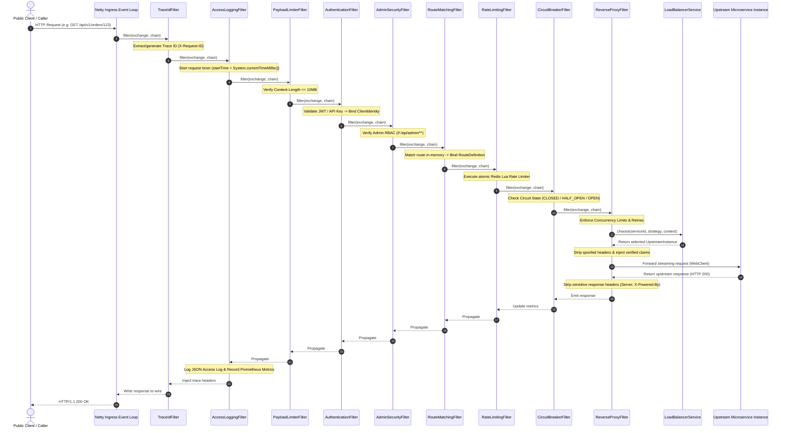

# Smart-Proxy: End-to-End Request Propagation & Execution Flow

This document details the exact lifecycle of an incoming HTTP request as it enters **Smart-Proxy**, propagates through the non-blocking reactive filter chain, executes security, routing, rate limiting, circuit breaking, load balancing, and returns the response back to the client.

---

## 1. High-Level Flow Diagram

---

## 2. Detailed Step-by-Step Propagation Flow

---

### Step 1: Ingress Transport & Trace ID Injection
* **Class**: [`com.smartproxy.core.foundation.TraceIdFilter`](file:///c:/java-projects/Smart-Proxy/src/main/java/com/smartproxy/core/foundation/TraceIdFilter.java)
* **Method Executed**: `filter(ServerWebExchange exchange, WebFilterChain chain)`
* **Filter Order**: `Ordered.HIGHEST_PRECEDENCE + 0`
* **What happens**:
  1. Inspects incoming headers for `X-Request-ID` or `X-Gateway-Trace-ID`.
  2. If absent, generates a unique UUID (e.g. `req-f8a1c9e2-...`).
  3. Binds the trace ID to the exchange attribute `TraceIdFilter.TRACE_ID_ATTR`.
  4. Registers a response `beforeCommit` hook to inject `X-Request-ID` and `X-Gateway-Trace-ID` into the client HTTP response headers.

---

### Step 2: Access Logging & Latency Measurement Initialization
* **Class**: [`com.smartproxy.core.foundation.AccessLoggingFilter`](file:///c:/java-projects/Smart-Proxy/src/main/java/com/smartproxy/core/foundation/AccessLoggingFilter.java)
* **Method Executed**: `filter(ServerWebExchange exchange, WebFilterChain chain)`
* **Filter Order**: `Ordered.HIGHEST_PRECEDENCE + 10`
* **What happens**:
  1. Captures `long startTime = System.currentTimeMillis()`.
  2. Sets up a reactive `doFinally()` hook.
  3. Upon request completion, calculates `durationMs = System.currentTimeMillis() - startTime`.
  4. Invokes [`StructuredAccessLogger.logAccess(...)`](file:///c:/java-projects/Smart-Proxy/src/main/java/com/smartproxy/telemetry/StructuredAccessLogger.java) to emit a structured JSON access log.
  5. Invokes [`GatewayMetricsService.recordHttpRequest(...)`](file:///c:/java-projects/Smart-Proxy/src/main/java/com/smartproxy/telemetry/GatewayMetricsService.java) to record Prometheus metrics and latency percentiles (p50, p90, p95, p99).

---

### Step 3: Oversized Request Payload Protection
* **Class**: [`com.smartproxy.core.foundation.PayloadLimiterFilter`](file:///c:/java-projects/Smart-Proxy/src/main/java/com/smartproxy/core/foundation/PayloadLimiterFilter.java)
* **Method Executed**: `filter(ServerWebExchange exchange, WebFilterChain chain)`
* **Filter Order**: `Ordered.HIGHEST_PRECEDENCE + 50`
* **What happens**:
  1. Inspects `exchange.getRequest().getHeaders().getContentLength()`.
  2. If `contentLength > maxPayloadBytes` (default: 10MB), halts propagation immediately.
  3. Returns `Mono.error(GatewayException.payloadTooLarge(...))` triggering an RFC 7807 `413 Payload Too Large` error response.

---

### Step 4: Authentication & Client Identity Resolution
* **Class**: [`com.smartproxy.core.auth.AuthenticationFilter`](file:///c:/java-projects/Smart-Proxy/src/main/java/com/smartproxy/core/auth/AuthenticationFilter.java)
* **Method Executed**: `filter(ServerWebExchange exchange, WebFilterChain chain)`
* **Filter Order**: `Ordered.HIGHEST_PRECEDENCE + 60`
* **What happens**:
  1. Checks for `Authorization: Bearer <jwt>` header:
     - Invokes [`JwtTokenService.validateAndExtract(token)`](file:///c:/java-projects/Smart-Proxy/src/main/java/com/smartproxy/core/auth/JwtTokenService.java) verifying HMAC-SHA256 signature and expiration.
  2. Checks for `X-API-Key: <key>` header:
     - Invokes [`ApiKeyService.validateApiKey(rawKey)`](file:///c:/java-projects/Smart-Proxy/src/main/java/com/smartproxy/core/auth/ApiKeyService.java) computing the SHA-256 hash and looking up credentials in [`ApiClientRegistry.findByHashedKey(hash)`](file:///c:/java-projects/Smart-Proxy/src/main/java/com/smartproxy/core/auth/ApiClientRegistry.java).
  3. If unauthenticated, instantiates [`ClientIdentity.anonymous(clientIp)`](file:///c:/java-projects/Smart-Proxy/src/main/java/com/smartproxy/core/auth/ClientIdentity.java).
  4. Binds the resolved `ClientIdentity` to `exchange.getAttribute(AUTHENTICATED_IDENTITY_ATTR)`.

---

### Step 5: Admin Control Plane Role-Based Access Control (Admin RBAC)
* **Class**: [`com.smartproxy.core.auth.AdminSecurityFilter`](file:///c:/java-projects/Smart-Proxy/src/main/java/com/smartproxy/core/auth/AdminSecurityFilter.java)
* **Method Executed**: `filter(ServerWebExchange exchange, WebFilterChain chain)`
* **Filter Order**: `Ordered.HIGHEST_PRECEDENCE + 70`
* **What happens**:
  1. If path starts with `/api/admin/**`:
     - Checks `X-Admin-Key` header or verified `ClientIdentity.roles()`.
     - `SYSTEM_ADMIN`: Grants full access.
     - `OPERATOR`: Permits read-only + operational actions (`/api/admin/config/sync`, `/api/admin/telemetry/circuit-breakers/**`); rejects route/policy mutations with `403 Forbidden`.
     - `AUDITOR`: Permits only `GET` requests; rejects write operations with `403 Forbidden`.
  2. Public traffic passes directly through.

---

### Step 6: In-Memory Dynamic Route Matching
* **Class**: [`com.smartproxy.core.routing.RouteMatchingFilter`](file:///c:/java-projects/Smart-Proxy/src/main/java/com/smartproxy/core/routing/RouteMatchingFilter.java)
* **Method Executed**: `filter(ServerWebExchange exchange, WebFilterChain chain)`
* **Filter Order**: `Ordered.HIGHEST_PRECEDENCE + 100`
* **What happens**:
  1. Invokes [`InMemoryRouteRegistry.match(method, path)`](file:///c:/java-projects/Smart-Proxy/src/main/java/com/smartproxy/core/routing/InMemoryRouteRegistry.java).
  2. Evaluates registered routes using [`PathMatcher.match(pattern, path)`](file:///c:/java-projects/Smart-Proxy/src/main/java/com/smartproxy/core/routing/PathMatcher.java).
  3. If no route matches:
     - Returns `Mono.error(GatewayException.notFound(...))` with HTTP `404 Not Found`.
  4. If matched:
     - Binds the active [`RouteDefinition`](file:///c:/java-projects/Smart-Proxy/src/main/java/com/smartproxy/core/model/RouteDefinition.java) to `exchange.getAttribute(MATCHED_ROUTE_ATTR)`.

---

### Step 7: Distributed Multi-Tier Rate Limiting (Redis Lua)
* **Class**: [`com.smartproxy.ratelimiter.RateLimitingFilter`](file:///c:/java-projects/Smart-Proxy/src/main/java/com/smartproxy/ratelimiter/RateLimitingFilter.java)
* **Method Executed**: `filter(ServerWebExchange exchange, WebFilterChain chain)`
* **Filter Order**: `Ordered.HIGHEST_PRECEDENCE + 200`
* **What happens**:
  1. Extracts policy from `RouteDefinition.getRateLimitPolicyId()`.
  2. Resolves partition key via [`RateLimitKeyResolver.resolveKey(exchange, policy.limitBy())`](file:///c:/java-projects/Smart-Proxy/src/main/java/com/smartproxy/ratelimiter/RateLimitKeyResolver.java) (IP, API Key, User, Tenant, or Route).
  3. Retrieves rate limiter from [`RateLimiterFactory.getRateLimiter(policy.algorithm())`](file:///c:/java-projects/Smart-Proxy/src/main/java/com/smartproxy/ratelimiter/RateLimiterFactory.java).
  4. Calls [`RedisTokenBucketRateLimiter.isAllowed(key, policy)`](file:///c:/java-projects/Smart-Proxy/src/main/java/com/smartproxy/ratelimiter/RedisTokenBucketRateLimiter.java).
  5. Executes atomic server-side Lua script on Redis (`redis.call('TIME')`, `HMGET`, `HSET`, `EXPIRE`).
  6. If rejected (`!result.allowed()`):
     - Sets headers `Retry-After: <seconds>` and `X-RateLimit-Remaining: 0`.
     - Returns `Mono.error(GatewayException.rateLimitExceeded(...))` with RFC 7807 `429 Too Many Requests`.

---

### Step 8: Custom Reactive Circuit Breaker Protection
* **Class**: [`com.smartproxy.circuitbreaker.CircuitBreakerFilter`](file:///c:/java-projects/Smart-Proxy/src/main/java/com/smartproxy/circuitbreaker/CircuitBreakerFilter.java)
* **Method Executed**: `filter(ServerWebExchange exchange, WebFilterChain chain)`
* **Filter Order**: `Ordered.HIGHEST_PRECEDENCE + 400`
* **What happens**:
  1. Retrieves circuit breaker instance via [`CircuitBreakerRegistry.getOrCreate(serviceId, config)`](file:///c:/java-projects/Smart-Proxy/src/main/java/com/smartproxy/circuitbreaker/CircuitBreakerRegistry.java).
  2. Calls [`CustomCircuitBreaker.execute(supplier)`](file:///c:/java-projects/Smart-Proxy/src/main/java/com/smartproxy/circuitbreaker/CustomCircuitBreaker.java).
  3. Evaluates current state:
     - **`OPEN`**: Fast-fails immediately with `GatewayException.serviceUnavailable(...)` (`HTTP 503`) without touching downstream network.
     - **`HALF_OPEN`**: Decrements permit count via atomic CAS; admits trial probe.
     - **`CLOSED`**: Passes request to execution pipeline.
  4. Tracks latency and outcomes in [`SlidingWindowMetrics`](file:///c:/java-projects/Smart-Proxy/src/main/java/com/smartproxy/circuitbreaker/SlidingWindowMetrics.java) ring buffer.

---

### Step 9: L7 Load Balancing, Header Cleansing & Outbound Proxy Forwarding
* **Class**: [`com.smartproxy.core.proxy.ReverseProxyFilter`](file:///c:/java-projects/Smart-Proxy/src/main/java/com/smartproxy/core/proxy/ReverseProxyFilter.java)
* **Method Executed**: `filter(...)` and `forwardToInstance(...)`
* **Filter Order**: `Ordered.LOWEST_PRECEDENCE - 100`
* **What happens**:
  1. **Concurrency Limiting**: [`OutboundConcurrencyLimiter.executeWithConcurrencyLimit(serviceId, maxConcurrency, proxyOperation)`](file:///c:/java-projects/Smart-Proxy/src/main/java/com/smartproxy/core/proxy/retry/OutboundConcurrencyLimiter.java) checks in-flight active requests.
  2. **Retry Wrapper**: [`ReactiveRetryExecutor.executeWithRetry(...)`](file:///c:/java-projects/Smart-Proxy/src/main/java/com/smartproxy/core/proxy/retry/ReactiveRetryExecutor.java) wraps execution with deadline budget and idempotent retry policy.
  3. **Load Balancing**: [`LoadBalancerService.choose(serviceId, strategy, context)`](file:///c:/java-projects/Smart-Proxy/src/main/java/com/smartproxy/loadbalancer/LoadBalancerService.java) selects a healthy [`UpstreamInstance`](file:///c:/java-projects/Smart-Proxy/src/main/java/com/smartproxy/loadbalancer/UpstreamInstance.java) using configured strategy:
     - [`RoundRobinStrategy.select(...)`](file:///c:/java-projects/Smart-Proxy/src/main/java/com/smartproxy/loadbalancer/strategy/RoundRobinStrategy.java)
     - [`WeightedRoundRobinStrategy.select(...)`](file:///c:/java-projects/Smart-Proxy/src/main/java/com/smartproxy/loadbalancer/strategy/WeightedRoundRobinStrategy.java)
     - [`LeastConnectionsStrategy.select(...)`](file:///c:/java-projects/Smart-Proxy/src/main/java/com/smartproxy/loadbalancer/strategy/LeastConnectionsStrategy.java)
     - [`PowerOfTwoChoicesStrategy.select(...)`](file:///c:/java-projects/Smart-Proxy/src/main/java/com/smartproxy/loadbalancer/strategy/PowerOfTwoChoicesStrategy.java)
  4. **Path Rewriting**: [`PathMatcher.stripPrefix(originalPath, count)`](file:///c:/java-projects/Smart-Proxy/src/main/java/com/smartproxy/core/routing/PathMatcher.java) strips URL prefixes according to route configuration.
  5. **SSRF Validation**: [`SsrfProtectionValidator.validateTargetUri(targetUri)`](file:///c:/java-projects/Smart-Proxy/src/main/java/com/smartproxy/core/proxy/SsrfProtectionValidator.java) verifies target is not cloud metadata (`169.254.169.254`) or link-local.
  6. **Zero-Trust Header Cleansing & Injection**: [`ProxyHeaderUtils.buildUpstreamHeaders(...)`](file:///c:/java-projects/Smart-Proxy/src/main/java/com/smartproxy/core/proxy/ProxyHeaderUtils.java) strips client spoofed headers (`x-authenticated-*`), injects `X-Forwarded-For`, `X-Forwarded-Proto`, `X-Request-ID`, and verified identity headers.
  7. **Outbound Streaming**: [`HttpProxyClient.forward(...)`](file:///c:/java-projects/Smart-Proxy/src/main/java/com/smartproxy/core/proxy/HttpProxyClient.java) dispatches reactive Netty WebClient request to backend instance.
  8. **Load Balancer Tracking**: [`LoadBalancerService.trackExecution(...)`](file:///c:/java-projects/Smart-Proxy/src/main/java/com/smartproxy/loadbalancer/LoadBalancerService.java) increments in-flight active connection count on the instance and decrements in `doFinally()`.

---

### Step 10: Response Processing & Client Return
* **Class**: [`com.smartproxy.core.proxy.ProxyHeaderUtils`](file:///c:/java-projects/Smart-Proxy/src/main/java/com/smartproxy/core/proxy/ProxyHeaderUtils.java) & [`AccessLoggingFilter`](file:///c:/java-projects/Smart-Proxy/src/main/java/com/smartproxy/core/foundation/AccessLoggingFilter.java)
* **What happens**:
  1. [`ProxyHeaderUtils.filterResponseHeaders(upstreamHeaders)`](file:///c:/java-projects/Smart-Proxy/src/main/java/com/smartproxy/core/proxy/ProxyHeaderUtils.java) strips hop-by-hop and internal backend leakage headers (`Server`, `X-Powered-By`, `X-AspNet-Version`, `X-Runtime`).
  2. Sets HTTP status code and streams response `DataBuffer` chunks back to client.
  3. `AccessLoggingFilter` fires completion:
     - [`StructuredAccessLogger.logAccess(...)`](file:///c:/java-projects/Smart-Proxy/src/main/java/com/smartproxy/telemetry/StructuredAccessLogger.java) outputs structured JSON log.
     - [`GatewayMetricsService.recordHttpRequest(...)`](file:///c:/java-projects/Smart-Proxy/src/main/java/com/smartproxy/telemetry/GatewayMetricsService.java) updates RPS counters and latency timers.
